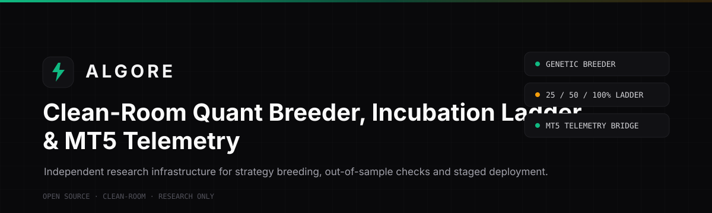
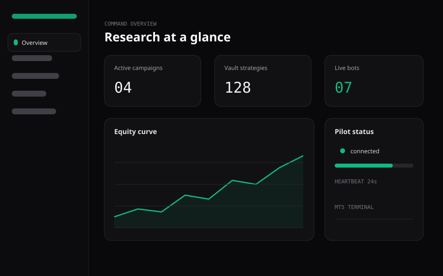
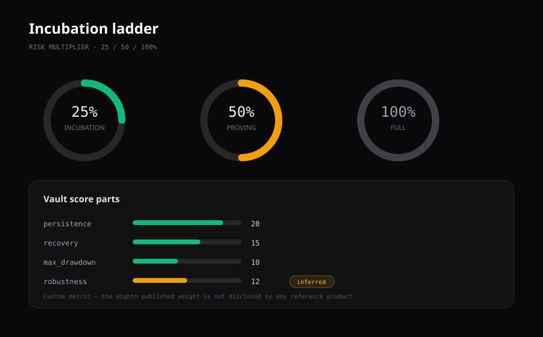
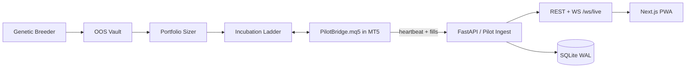

<div align="center">



[](LICENSE)
[](engine/requirements.txt)
[](dashboard/package.json)
[](engine/app/api.py)
[](engine/mql5)
[](engine/tests)
[](CONTRIBUTING.md)

**Independent, clean-room research infrastructure for quantitative strategy breeding, staged incubation, and MetaTrader 5 telemetry.**

[](https://vercel.com/new/clone?repository-url=https://github.com/Ferry737/algore&root-directory=dashboard)

</div>

## See the interface

<p align="center">
  
  
</p>

The dashboard runs in **Demo Mode** without a backend. Open Connection → **Demo mode** to switch instantly; no key, no server, no network needed.

## Four pillars

1. **Genetic strategy breeder & OOS vault** — bounded genome grammar, population crossover and mutation, walk-forward train/test/OOS split, anti-overfit gates, and a searchable strategy passport.
2. **Parity backtester + `.mq5` exporter** — event-driven bar simulation with spread, commission and slippage, plus generation of compilable MQL5 Expert Advisor source from a strategy genome.
3. **Dual-path incubation ladder** — `INCUBATION 25% → PROVING 50% → FULL 100%`, with a live-trade path and a post-training replay fast-track. Ladder changes alter sizing for *subsequent* entries only; open positions are never mutated.
4. **Mobile-first animated PWA** — Next.js App Router, TypeScript, framer-motion, iPhone-safe layout, runtime endpoint/key settings in localStorage, and standard WebSocket live updates.

## Architecture



## Quickstart

### 1. Engine

Docker Compose:

```bash
cd deploy
cp .env.example .env
# edit .env: set ALGORE_JWT_SECRET and ALGORE_DASHBOARD_API_KEY
docker compose up -d --build
curl http://127.0.0.1:8000/api/v1/health
```

Or a local Python virtual environment:

```bash
cd engine
python3 -m venv .venv
. .venv/bin/activate
pip install -r requirements.txt
export ALGORE_JWT_SECRET=$(openssl rand -hex 32)
export ALGORE_DASHBOARD_API_KEY=$(openssl rand -hex 32)
uvicorn app.api:app --host 127.0.0.1 --port 8000 --workers 1
```

Engine tests:

```bash
cd engine && pytest -v
```

### 2. Dashboard

```bash
cd dashboard
npm install
npm run dev
```

Open `http://localhost:3000`. The baked API default is `http://localhost:8000`; with no backend, tap **Connection → Demo mode** for a fully offline simulated feed.

Production build:

```bash
NODE_OPTIONS="--max-old-space-size=2048" npm run lint && npm run build
```

### 3. MT5 telemetry bridge

1. Copy `engine/mql5/PilotBridge.mq5` and `engine/mql5/EA_EXAMPLE.mq5` into your MetaTrader 5 `MQL5/Experts` folder.
2. In MetaEditor, compile both files. The source is provided but **not compiled here**.
3. Generate a pilot token through `/api/v1/pilot/token`, paste it into the EA inputs, and allow `WebRequest` for your API host in MT5 terminal settings.
4. Start on a **demo account** first. Heartbeats and fills land at `/api/v1/pilot/ingest` and drive the incubation ladder.

## Honest methodology & risk disclaimer

This is **research and infrastructure software, not financial advice**. It does not predict markets and does not guarantee returns. The breeder, scoring weights and incubation ladder are clean-room designs; where a published detail was not publicly verifiable it is labelled `inferred` in the UI and documentation rather than guessed.

Before risking capital: independently verify every strategy out of sample, model **all** transaction costs (spread, commission, slippage, funding, gas where relevant), check maximum drawdown and sample size, and validate the whole stack on a demo account. Treat every backtest as overfit until proven otherwise. You are responsible for compliance with your broker, jurisdiction, and tax rules; ask a qualified professional where needed.

## Layout

```text
engine/     FastAPI service, breeder, backtester, incubator, sizer, MQL5 exporter, tests
dashboard/  Next.js App Router PWA with runtime connection settings
deploy/     Docker Compose, Dockerfile, run script, example environment
docs/       Visual assets
```

## Contributing

See [CONTRIBUTING.md](CONTRIBUTING.md). Issues and pull requests are welcome.

## License

MIT © 2026 Ferry737. See [LICENSE](LICENSE).
